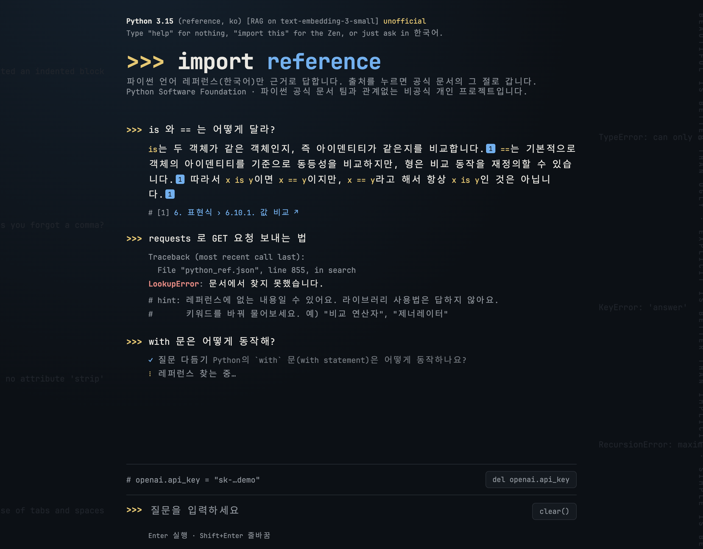

# import reference

> **비공식 개인 프로젝트**입니다.

**사용해 보기: https://import-reference.onrender.com** (OpenAI API 키 필요)

파이썬 언어 레퍼런스(한국어)를 근거로 답하는 RAG 챗봇. 답마다 근거로 쓴 공식 문서의 절을 링크로 붙인다.

- 답하는 것: 연산자 · 문장(if, for, with …) · 데이터 모델 · 임포트 · 어휘 규칙
- 답하지 않는 것: 라이브러리 사용법 · 설치 · 에러 디버깅. 레퍼런스에 없으면 "문서에서 찾지 못했습니다"라고 답한다.



## 동작

1. 질문을 LLM으로 검색용 질문으로 다시 쓴다 (대화 맥락 풀기 · 기호에 공식 용어 붙이기)
2. 하이브리드 검색: 임베딩(코사인 유사도) 상위 3개 + 키워드(BM25, 한글 bigram) 상위 3개
3. 찾은 조각만 근거로 답을 스트리밍한다. 문장마다 `[번호]`로 출처를 단다.

- 답변 모델 `gpt-6-luna` · 임베딩 `text-embedding-3-small`
- 인덱스 `data/python_ref.json`: Language Reference 1~9장 · 273개 절 · 855개 조각

## API 키

이 앱은 서버에 OpenAI 키를 두지 않는다. 사용자가 화면에서 자기 키를 넣는다.

- 키는 브라우저 `sessionStorage`에만 저장된다. 탭을 닫으면 사라진다.
- 질문할 때 `X-OpenAI-Key` 헤더로 서버에 보내고, 서버는 그 요청에만 쓴다. 파일 · 로그에 남기지 않는다.
- 질문 1번에 LLM 2번 · 임베딩 1번을 부르고, 요금은 그 키의 계정에 나간다.

## 구조

```
server/          앱 (배포되는 코드)
  app.py         Flask 라우트 · 입력 검사 · 요청 제한
  chain.py       키 · 에러 변환 · 질문 다시 쓰기 · 답 스트리밍
  search.py      인덱스 불러오기 · 임베딩 + BM25 하이브리드 검색
  templates/ static/
scripts/         관리용 스크립트 (인덱스 만들기 · 검색 비교)
data/            python_ref.json
```

## 실행

```bash
pip install -r requirements.txt
python -m server.app                 # 로컬 개발 · http://127.0.0.1:5000
```

배포:

```bash
gunicorn server.app:app --worker-class gthread --threads 8 --timeout 120
```

- 답을 스트리밍하는 동안 다른 요청이 막히지 않도록 스레드 워커(`gthread`)로 띄운다.
- 배포 환경에 `OPENAI_API_KEY`를 넣지 않는다. 앱은 사용자가 보낸 키만 쓴다.
- HTTPS로만 서비스한다. 키가 요청 헤더로 오간다.

## 제한

- 질문 1,000자 · 대화 기록 최근 6개(메시지당 4,000자) · 요청 본문 64KB
- IP마다 `/ask` 분당 10번 · 하루 200번 (프로세스 메모리 기준이라 서버 1대일 때만 정확하다)

## 인덱스 다시 만들기

문서가 바뀌었을 때만. `.env.example`을 `.env`로 복사한 뒤 `OPENAI_API_KEY`를 넣는다.

```bash
python -m scripts.build_index      # docs.python.org/ko/3/reference/ 를 1초에 1번씩 받아 data/python_ref.json 저장
python -m scripts.eval_search      # 검색 비교: 질문 10개로 임베딩 · 키워드 · 하이브리드
```

## 출처 · 라이선스

- 데이터: [Python 언어 레퍼런스 (한국어)](https://docs.python.org/ko/3/reference/) © Python Software Foundation. [PSF 문서 라이선스](https://docs.python.org/3/license.html)를 따른다.
- 글꼴: [Jetendard](https://github.com/kuskhan/jetendard) v0.1.0 공식 웹폰트(JetBrains Mono Nerd Font + Pretendard 한글) · SIL Open Font License 1.1 · `server/static/fonts/OFL.txt`
